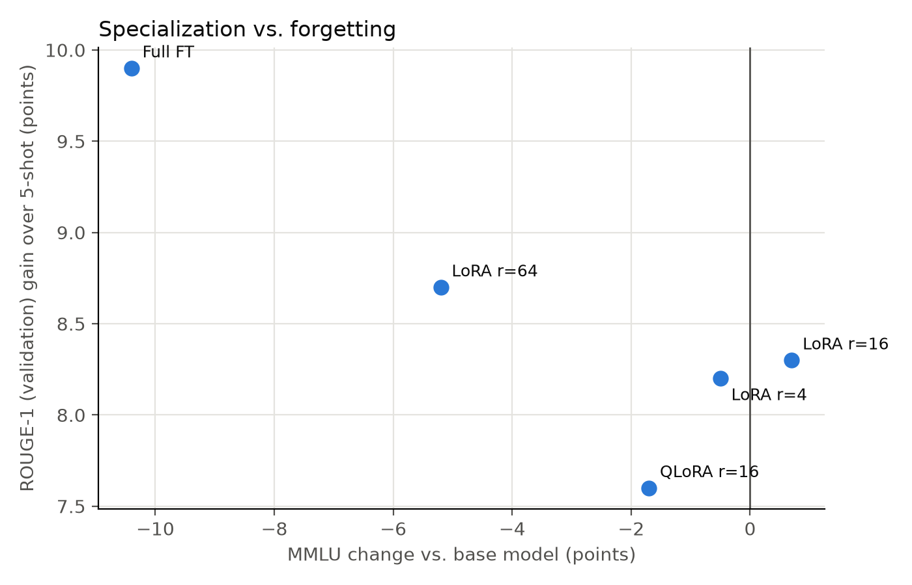

# Prompting, LoRA, QLoRA, or Full Fine-Tuning? Dialogue Summarization with Qwen2.5-0.5B

## Summary
The **objective** of this mini-project was to fine-tune Qwen2.5-0.5B-Instruct to summarize dialogues from SAMSum while measuring forgetting and the cost. My **approach** was to first consider different methods: prompt engineering, LoRA, QLoRA, and full fine-tuning. ROUGE-1 was used to measure a model's ability to summarize. To measure a model's general forgetting, Massive Multitask Language Understanding (MMLU) was used which measures a model's general knowledge.

The models were compared with the base model (the original Qwen2.5-0.5B-Instruct before fine-tuning): with its best prompt engineering (5-shot ROUGE-1 points) and MMLU points. The highest gains in ROUGE-1 points came from the full fine-tuned model at an increase of 10.5 points, but at a cost of the highest forgetting, a decrease of 10.4 MMLU points. LoRA rank=16 gained 9 ROUGE-1 points from the base model's score, nearly reached the highest gains, while showing no signs of forgetting (gained 0.7 MMLU points).

The models were trained on Kaggle's free tier (2x NVIDIA T4, 16 GB each).

## Results
Key findings:
- Fine-tuning beats prompting by 8 - 10.5 ROUGE-1 points on the test set.
- More trainable parameters improve the ROUGE-1 score slightly, but increase forgetting (MMLU) more rapidly.
- LoRA rank=16 had near best ROUGE-1 score and showed no sign of forgetting.
- QLoRA rank=16 saved little memory, but that saving did not outweigh the increase in training time. ROUGE-1 results are 1 point less than LoRA rank=16.
- ROUGE-1/2/L scores on validation set and test set produced similar scores. The order of ROUGE-1 scores on the models was preserved on both the validation set and test set.

| Method     |   Rouge 1 |   Rouge 2 |   Rouge L |   MMLU | trainable parameters   |   train min | peak memory allocated on gpu (GB) |   eval min |   val loss |
|:-----------|---------:|---------:|---------:|-------:|:-------------------|------------:|:--------------|-----------:|------------:|
| 5-shot     |     37.4 |     12.5 |     28.4 |   41.1 | -               |       -   |       -       |       17.2 |      -      |
| LoRA r=16  |     46.4 |     19.7 |     36.9 |   41.8 | 8798208            |        17.9 | 11.25         |       21.6 |      1.3091 |
| LoRA r=64  |     47.1 |     20.7 |     37.7 |   35.9 | 35192832           |        18   | 11.56         |       21.5 |      1.2978 |
| QLoRA r=16 |     45.4 |     19   |     36.4 |   39.4 | 8798208            |        26.4 | 10.9          |       21.8 |      1.3277 |
| Full FT    |     47.9 |     21.8 |     38.7 |   30.7 | 494032768          |        24.9 | >14.5         |       10.9 |      1.312  |

Notes:
- ROUGE = test set (819 dialogues)
- MMLU = 1,000 fixed questions
- Full FT = checkpoint-900 (see Section What went wrong)
- Metrics from training runs: train min, peak memory allocated, val loss
- eval min measures the time to generate Rouge summaries from the test set and evaluate Rouge scores.

## Figures
In the next two figures, ROUGE-1 scores are computed on the validation set and include all the models that were considered.

The scatter plot illustrates that as the number of trainable parameters increases, the ROUGE-1 score increases at a very slow rate. Differences in ROUGE-1 are small.

The plot illustrates that generally the more the model specializes (increases ROUGE-1 score), the more the model forgets its general knowledge (MMLU score decreases). The exceptions are LoRA rank=4 and LoRA rank=16 showing no measurable forgetting (LoRA rank=16 increased slightly).
## Quantization
Key Findings:
- Quantization reduced model footprint by 52% for 4bit (34.3% for 8bit).
- Quantization made the MMLU scoring slower by 1.5 times for 4bit (2.75 for 8bit) than without quantization. ROUGE generation and scoring were also slower by similar ratios.
- Changes in quality (ROUGE-1/2/L and MMLU points) were small.

Quantization was applied to the best all-around model, LoRA rank=16, and evaluated on the validation set.

| quant   |   model footprint GB |   peak_gen_gb |   peak_mmlu_gb |   rouge1 |   rouge2 |   rougeL |   mmlu |   rouge_min |   mmlu_min |
|:--------|---------------:|--------------:|---------------:|---------:|---------:|---------:|-------:|------------:|-----------:|
| none    |           1.02 |          1.14 |           1.5  |     47.1 |     21.3 |     37.7 |   41.7 |        21.9 |        1.2 |
| 8bit    |           0.67 |          0.77 |           1.13 |     47.5 |     21.3 |     37.7 |   40.5 |        59.1 |        3.3 |
| 4bit    |           0.49 |          0.6  |           0.96 |     46.2 |     20   |     36.6 |   40.4 |        30.5 |        1.8 |

Notes:
- `peak_gen_gb` and `peak_mmlu_gb` record the peak memory allocated during the summarizing/ROUGE-1/2/L testing and MMLU testing, respectively.
- `rouge_min` is the time needed to summarize the validation set and run the ROUGE-1/2/L tests.

## What went wrong
- Full fine-tuning ran out of memory at step 920/921. Checkpoint at step 900 was used. At step 900 the learning rate was about 3e-8, so any changes after that were small. The crash showed that training needed more than 14.5 GB of allocated memory. The T4's max capacity is 14.56 GiB (about 15.6 GB), about 0.9 GiB of it was reserved but unused (fragmented).
- A batch size of 4 per GPU ran out of memory, so switched to batch size of 2 per GPU and doubled the gradient accumulation steps to keep the effective batch size at 16.
- In a short test, DataParallel GPU 0 peaked at about 14.8 GB (vs 11.3 GB with on GPU), close to the T4's limit. I switched to DistributedDataParallel and the full LoRA r=16 runs peaked at 11.25 GB (GPU 0) and trained in about 18 min (vs about 33 min estimate for one GPU).
- Data set Samsung/samsum is no longer on Hugging Face, so ended up using knkarthick/samsum.

## Limitations
## Reproduce
- add a line about uninstalling torchao
## Repository layout